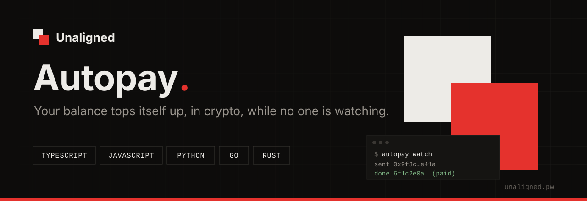
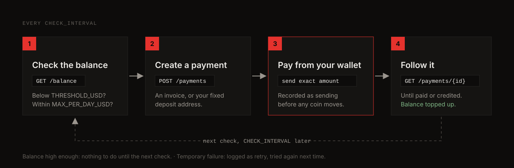
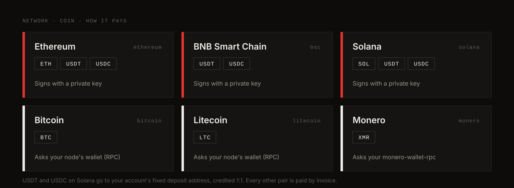
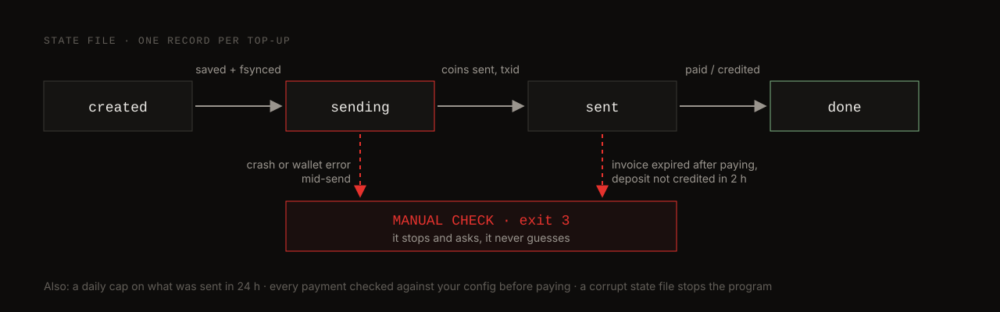

<p align="center">
  
</p>

<p align="center">
  <a href="https://github.com/UnalignedSA/autopay/actions/workflows/ci.yml"></a>
  <a href="LICENSE"></a>
  
  
</p>

<p align="center">
  <a href="#quick-start">Quick start</a> ·
  <a href="#how-it-works">How it works</a> ·
  <a href="#supported-networks">Networks</a> ·
  <a href="#configuration">Configuration</a> ·
  <a href="#safety">Safety</a> ·
  <a href="https://unaligned.pw/docs/payments">Payments API</a>
</p>

---

**Autopay** keeps an [Unaligned](https://unaligned.pw) balance from ever running dry. A small program watches
the balance. When it drops below a threshold, the program asks the
[Payments API](https://unaligned.pw/docs/payments) for a top-up, pays it from a wallet you control, and
follows it until it is credited. No dashboard to open, no human in the loop.

It is built for apps, bots and AI agents that call the API around the clock, and it is short enough to
read in one sitting. The same program comes in **five languages**, with the same configuration, the same
behaviour and the same state file. Run one as it is, or copy the parts you need into your own code.

| | Language | Requires | Start |
|---|---|---|---|
| [`typescript/`](typescript) | TypeScript, the reference | Node 22.18+ | `npm install && npm run build && npm start -- watch` |
| [`node/`](node) | JavaScript | Node 22.9+ | `npm install && npm start -- watch` |
| [`python/`](python) | Python | Python 3.11+ | `pip install -e . && python -m autopay watch` |
| [`go/`](go) | Go | Go 1.25+ | `go build -o autopay ./cmd/autopay && ./autopay watch` |
| [`rust/`](rust) | Rust | Rust 1.98.1+ | `cargo build --release && ./target/release/autopay watch` |

> [!IMPORTANT]
> **2.0.0.** The API's payment fields are now snake_case (`amount_usd`, `amount_crypto`, `expires_at`,
> `tx_hash`) with times in seconds, and `GET /payments/methods` answers `{"methods": [...]}`. Autopay 1.x no
> longer works against the API: it stops or retries at start and pays nothing. Upgrade to 2.0.0. State
> files are compatible: keep yours as it is.

## Quick start

1. **Create an API key** for the account to top up on [unaligned.pw](https://unaligned.pw).
2. **Fund a dedicated wallet** with a few top-ups' worth, never your main wallet.
3. **Configure and try it** without sending anything:

```sh
cd go                                  # or typescript, node, python, rust
cp ../.env.example .env                # then fill it in
go build -o autopay ./cmd/autopay
DRY_RUN=1 ./autopay once               # prints what it would send, sends nothing
./autopay watch                        # the real thing
```

A minimal `.env` for USDT on BNB Smart Chain:

```sh
UNALIGNED_KEY=...
NETWORK=bsc
COIN=USDT
THRESHOLD_USD=10        # top up when the balance drops below $10
TOPUP_USD=50            # by $50 each time
MAX_PER_DAY_USD=200     # and never more than $200 in 24 hours
EVM_RPC_URL=https://...
EVM_PRIVATE_KEY=0x...
```

## How it works

<p align="center">
  
</p>

1. **Check.** Any top-up still in flight is followed first, and nothing else happens until it is done.
   Then `GET /balance`: at or above `THRESHOLD_USD`, there is nothing to do. A top-up that would go over
   `MAX_PER_DAY_USD` in 24 hours is refused.
2. **Create.** `POST /payments` for `TOPUP_USD` in your coin and network. Most pairs answer with an
   invoice. USDT and USDC on Solana answer with your account's fixed deposit address, credited 1:1.
3. **Pay.** The top-up is written to the state file as `sending`, then the exact `amountCrypto` is sent
   to `address`, then the record becomes `sent`.
4. **Follow.** `GET /payments/{id}`, or the deposit list, until it is `paid` or `credited`.

Crypto amounts are never floats. They stay decimal strings and become integer base units through exact
integer arithmetic.

## Supported networks

<p align="center">
  
</p>

| Network | `NETWORK` | `COIN` | Wallet variables |
|---|---|---|---|
| Ethereum | `ethereum` | `ETH`, `USDT`, `USDC` | `EVM_RPC_URL`, `EVM_PRIVATE_KEY` |
| BNB Smart Chain | `bsc` | `USDT`, `USDC` | `EVM_RPC_URL`, `EVM_PRIVATE_KEY` |
| Solana | `solana` | `SOL`, `USDT`, `USDC` | `SOLANA_RPC_URL`, `SOLANA_PRIVATE_KEY` |
| Bitcoin | `bitcoin` | `BTC` | `WALLET_RPC_URL`, `WALLET_RPC_USER`, `WALLET_RPC_PASSWORD` |
| Litecoin | `litecoin` | `LTC` | `WALLET_RPC_URL`, `WALLET_RPC_USER`, `WALLET_RPC_PASSWORD` |
| Monero | `monero` | `XMR` | `MONERO_WALLET_RPC_URL` (user and password optional) |

The pairs offered at any time are listed by the public `GET /payments/methods`. Tron is not supported yet.

- `SOLANA_PRIVATE_KEY` is a base58 secret key, or the JSON byte array of a `solana-keygen` file.
- `WALLET_RPC_URL` may include `/wallet/<name>` to pick one wallet of the node.

<details>
<summary><b>Built-in token contracts</b></summary>

<br>

| | USDT | USDC |
|---|---|---|
| Ethereum | `0xdAC17F958D2ee523a2206206994597C13D831ec7` | `0xA0b86991c6218b36c1d19D4a2e9Eb0cE3606eB48` |
| BSC | `0x55d398326f99059fF775485246999027B3197955` | `0x8AC76a51cc950d9822D68b83fE1Ad97B32Cd580d` |
| Solana | `Es9vMFrzaCERmJfrF4H2FYD4KCoNkY11McCe8BenwNYB` | `EPjFWdd5AufqSSqeM2qN1xzybapC8G4wEGGkZwyTDt1v` |

Token decimals are always read on chain. Native decimals: ETH 18, SOL 9, BTC 8, LTC 8, XMR 12.

</details>

## Configuration

Everything is set through environment variables. See [`.env.example`](.env.example) for a commented copy.
Every program also loads a `.env` file from its folder (or the current folder) when there is one. A
variable already set in the environment is never overridden by the file.

| Variable | Default | Notes |
|---|---|---|
| `UNALIGNED_KEY` | required | API key of the account to top up |
| `UNALIGNED_API` | `https://api.unaligned.pw/v1` | no trailing slash |
| `NETWORK`, `COIN` | required | a pair from [Supported networks](#supported-networks) |
| `THRESHOLD_USD` | required | number, > 0 |
| `TOPUP_USD` | required | whole dollars, from the method's `min_usd` to its `max_usd` |
| `MAX_PER_DAY_USD` | required | whole dollars, at least `TOPUP_USD` |
| `CHECK_INTERVAL` | `60` | seconds, minimum 15 |
| `DRY_RUN` | `0` | `1`: create the payment, print it, send nothing, write no state |
| `REFUND_ADDRESS` | the wallet's address (EVM, Solana) | where an incomplete payment goes back to |
| `STATE_FILE` | `./autopay-state.json` | use an absolute path under cron or systemd |
| `TOKEN_ADDRESS` | built in | the contract or mint of `COIN` itself. Leave it unset on mainnet |

Plus the wallet variables of your network, listed under [Supported networks](#supported-networks).

> [!TIP]
> **Quote values in `.env`.** Wrap any value that contains `#`, `$`, spaces or quotes in single quotes,
> for example `WALLET_RPC_PASSWORD='p#ss $word'`. The five languages read `.env` with different readers,
> and they disagree on unquoted values (Node cuts at `#`, Go's reader expands `$NAME`). All five take a
> single-quoted value literally. Such a value cannot itself contain a single quote. Variables set in the
> real environment are never parsed.

## Usage

```sh
autopay once    # one check, then exit (cron, systemd timer)
autopay watch   # check every CHECK_INTERVAL until stopped
```

| Exit code | Meaning |
|---|---|
| `0` | ok, or a temporary failure that will be retried (`once`) |
| `1` | fatal: configuration, bad key, corrupt state file, rejected request |
| `3` | [manual check](#manual-check) needed: the program could not tell whether money moved |

`watch` keeps going through temporary failures (network errors, timeouts, HTTP 5xx and 429). It logs
`retry: ...` and tries again on the next tick, and exits only on a fatal error or a manual check.

> [!NOTE]
> Run the Go program as a built binary. `go run` reports any failure of the program as exit `1`, so a
> manual check would look like a fatal error.

Under cron or systemd, set `STATE_FILE` to an absolute path and start the program from the folder that
holds `.env`. Both are found relative to the working directory, and a scheduler starts elsewhere (cron in
your home folder, systemd in `/`).

One log line per event, each prefixed by an ISO timestamp:

```
balance 42.5 >= threshold 10
created invoice 6f1c2e0a-...: send 50.00 USDT on bsc to 0x8c82...a4ac
sent 0xabc...
waiting 6f1c2e0a-... (confirming)
done 6f1c2e0a-... (paid)
daily cap reached (95/100 USD in 24h)
MANUAL CHECK: <reason>
retry: <reason>
```

## Safety

This program moves real money without asking. It is built to fail closed: when in doubt, it stops.

<p align="center">
  
</p>

- **Use a dedicated wallet** that holds little more than a few top-ups. The private key sits in an
  environment variable, so never point it at your main wallet.
- **`MAX_PER_DAY_USD` is your ceiling.** Whatever goes wrong (a bug, a loop, a repeated failure), the
  program will not send more than this in 24 hours. It counts what the state file records, so this holds
  as long as the state file is kept and only one copy runs on it.
- **Run one copy per state file.** Two copies on the same file cannot see each other's payment in flight:
  each could create and pay its own invoice. Under cron, wrap the program in `flock`, so a run never
  starts while the previous one is still going:

  ```
  */5 * * * * cd /srv/autopay/go && flock -n /srv/autopay/state.json.lock ./autopay once
  ```

  `flock -n` skips the run when the lock is taken instead of queueing it. A systemd service or timer
  already runs a single instance.
- **Start with `DRY_RUN=1`, with `once`.** It creates a payment, prints what it would send and sends
  nothing. Each dry run leaves an open invoice for 30 minutes and the API allows 3 open at a time, so do not
  dry-run under `watch`.
- **The payment must match the request.** Before anything is sent, the coin, network and amount of the
  answer must be the configured ones. On EVM, the chain id of `EVM_RPC_URL` must match `NETWORK`
  (1 for Ethereum, 56 for BSC). Otherwise the program stops with exit `1` and sends nothing.
- **A payment close to expiry is not sent.** After a restart, an invoice with less than 5 minutes left is
  left to expire, and a new one is made later.
- **Reseller customer keys get 403.** A customer key of a reseller cannot top up (the money would go to the
  reseller). Use the account's own key.

### Manual check

The program exits with code `3` and prints `MANUAL CHECK: <reason>` when it cannot know whether money
moved. It will not guess. Stop it, look, edit the state file, start it again.

| The state shows | What happened | What to do |
|---|---|---|
| `sending` | a crash or a wallet error in the middle of a send | Look at your wallet's history. **Sent:** set `phase` to `sent`, `txid` to the transaction id and `sentAt` to when it went out (ms since 1970). `sentAt` is what the daily cap counts. **Not sent:** set `phase` to `done` and `result` to `"failed"`. |
| `sent`, invoice `expired` | you paid, but the invoice expired first | A late payment is still credited. Check your balance and the wallet, then set `phase` to `done`. |
| `sent`, a `deposit` record | not credited 2 hours after the send | Look the transaction up on chain and check your balance, then set `phase` to `done` (and `result` to `"failed"` if it never landed). |

<details>
<summary><b>The state file</b></summary>

<br>

`autopay-state.json` records every top-up, so a restart never pays twice. It is written atomically
(temp file, fsync, rename) before every send.

```json
{ "version": 1, "topups": [ {
  "id": "6f1c2e0a-3b7d-4c55-9a51-2f0f6b8e4d21", "kind": "invoice",
  "network": "bsc", "coin": "USDT", "amountUsd": 50, "amountCrypto": "50.00", "address": "0x...",
  "expiresAt": 1793926800000, "phase": "created", "txid": null,
  "createdAt": 1793925000000, "sentAt": null, "result": null } ] }
```

- `phase` goes `created`, `sending`, `sent`, `done`.
- The field names are the program's own and every time is in milliseconds since 1970, whatever the API's
  own names and units are. A file written by 1.x is read as it is by 2.0.0.
- For a deposit, `id` is `deposit:pending` until the transaction id is known, then `deposit:<txid>`.
- `result` is the final status: `paid`, `expired`, `refunded`, `credited` or `failed`.
- Every field of every record is checked. If the file cannot be read or parsed, the program refuses to
  start. It never treats it as empty, which would forget a payment in flight.
- A file written by any of the five languages is read by the other four.

</details>

<details>
<summary><b>Behaviour details</b></summary>

<br>

These choices are the same in every language. Only the `.env` readers differ (see
[Configuration](#configuration)).

- **Order of checks at start.** The environment is validated first: required variables, Tron, numbers,
  `CHECK_INTERVAL`, the wallet variables of the network. Only then is `GET /payments/methods` called
  (public, sent without your key) to check the coin, network and amount.
- **Retries.** Network errors, timeouts, unreadable responses, HTTP 5xx and HTTP 429 are temporary.
  `watch` logs `retry: ...` and tries again on the next tick, including when the API is down at start.
  `once` logs it and exits `0`. HTTP 401, 403 and any other 4xx are fatal (`1`).
- **Daily cap.** A top-up is refused when `TOPUP_USD` plus what was sent in the last 24 hours is above
  `MAX_PER_DAY_USD`. The log shows what was already sent: `daily cap reached (45/50 USD in 24h)`. A record
  counts from `sentAt`. A hand-edited record without it (one with a `txid`, or in `sending` or `sent`)
  counts from `createdAt`.
- **The payment must match the request.** Before anything is sent, the coin and network of the answer
  must be the configured ones, and an invoice's `amount_usd` must equal `TOPUP_USD`. Otherwise the program
  stops with exit `1`, sends nothing and records nothing.
- **A resumed invoice must match too.** An invoice that was created but not sent (the program stopped in
  between) is only paid if its coin and network are still the configured ones. If you changed `NETWORK` or
  `COIN` meanwhile, the program stops with exit `1`. Set them back until the invoice is done, or close the
  record in the state file.
- **EVM chain id.** At start, the program reads the chain id of `EVM_RPC_URL` and stops with exit `1` if it
  is the other mainnet (chain id 1 with `NETWORK=bsc`, 56 with `NETWORK=ethereum`). It checks again before
  signing. Other chain ids are allowed, so test chains work. If the node does not answer at start, that is
  a temporary failure, like the API being down.
- **Invoice not `waiting`.** A `created` invoice (not yet sent) whose status is already something other
  than `waiting` and `expired` (for example `confirming`) is never paid again, and the cycle ends
  `Pending`. `paid` and `refunded` close it, and `expired` closes it as `expired`.
- **Deposits are given 2 hours.** A deposit record in `sent` that the deposit list still does not show as
  credited 2 hours after `sentAt` (or `createdAt` for a hand-edited record) stops the program with a
  manual check (exit `3`). A transaction not listed by then was most likely dropped.
- **The transaction id is never lost.** `sent <txid>` is logged before the state file is written, so it is
  on screen even if that write fails.
- **Dry run.** `DRY_RUN=1` still needs the wallet variables (the default refund address is the wallet's).

</details>

## Not included

Tron, hardware wallets, and anything that needs a human to approve a payment. Pull requests are welcome.

## License

[MIT](LICENSE). Made by [Unaligned](https://unaligned.pw): private AI, pay as you go.
